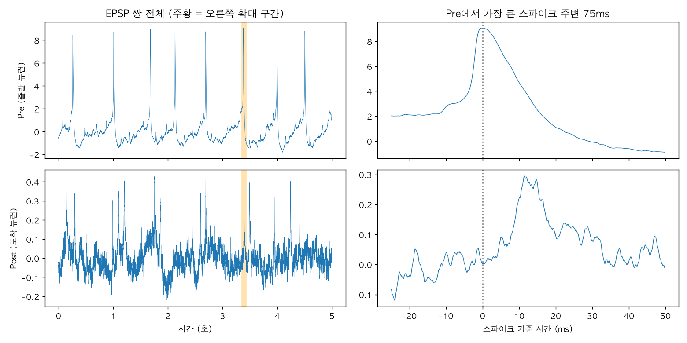
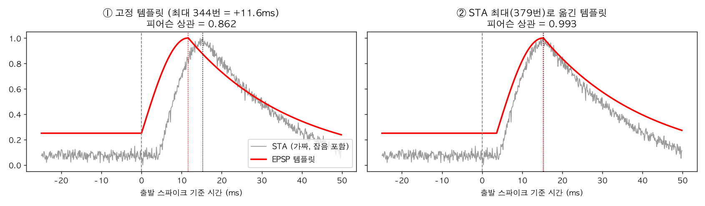
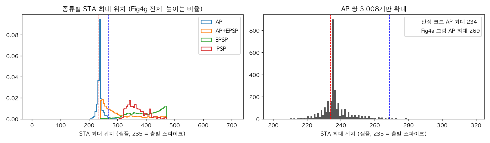
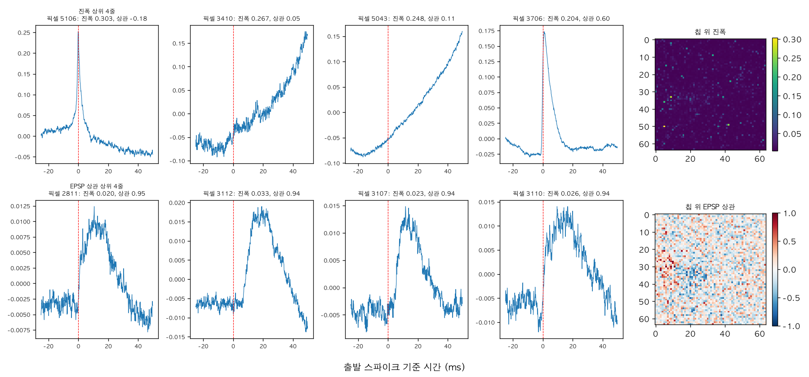

# 그림 노트

이해를 도운 그림과 그 설명을 모아 둔다. 그림마다: 무엇을 보여 주나 / 읽는 법 / 알게 된 것. 새 그림은 단계 순서대로 아래에 추가한다.
개념 요약표는 [CONCEPTS.md](CONCEPTS.md), 결정 과정은 [WORKLOG.md](WORKLOG.md).

---

## 세션 0 · 평균으로 잡음 줄이기

### 잡음 속 가짜 EPSP를 N번 평균 — `session0/averaging_demo.py`

- **비유:** 시끄러운 경기장에서 같은 말을 여러 번 녹음해 겹치면 목소리만 남는다.
- **알게 된 것:** 잡음이 신호의 10배여도 N=100이면 흐릿하게, N=1,000이면 뚜렷하게 보인다. 잡음은 1/√N로 준다 (N 4배 → 잡음 절반).

### 신호 대 잡음비 — `session0/snr_explained.py`

- **읽는 법:** 회색 띠 = 평균 후 남은 잡음, 빨간 화살표 = 신호 높이. 화살표가 띠의 몇 배인가가 S/N.

### 진짜 원신호 (Fig4d, EPSP 쌍) — `session0/raw_signal.py`

- **알게 된 것:** 5초에 출발 스파이크 8번뿐. 한 번만 보면 EPSP가 잡음에 묻힌다. 그래서 평균(STA)이 필요하다.

---

## M1 · 템플릿

### 샘플 = 시간 — `m1/sample_axis.py`

- **비유:** 전극은 1초에 9,415장 찍는 초고속 카메라. 샘플 1개 = 사진 1장 ≈ 0.106ms.
- **읽는 법:** STA 창 705샘플 = 스파이크 **전 25ms + 후 50ms**. 235번 샘플(빨간 점선)이 출발 스파이크 순간(0ms).
- **템플릿 = 세 토막:** 평평(pre) + 오름(rise) + 감쇠(나머지 칸 전부, τ는 가라앉는 속도). pre+rise가 705보다 작은 건 decay가 나머지를 채우기 때문.

### 신호 4종류 (그림 없음, 비유만)
- **컵에 차는 물:** EPSP = 물을 조금 부음(살짝 오름), IPSP = 조금 퍼 감(살짝 내려감), AP = 선을 넘으면 확 쏟아짐(크고 뾰족).
- **AP만 다음 뉴런으로 간다(말하기).** EPSP·IPSP는 받는 뉴런 안에서만 오르내린다(들은 말에 마음이 기움).
- **억제성 = 회의의 반대표.** 아무 표도 안 온 것(연결 없음)과 다르다. 흥분이 폭주하지 않게 하는 브레이크.
- **템플릿 4개의 뜻 (A의 AP 직후 B의 모양):** EPSP = 약한 흥분성, IPSP = 억제성, AP+EPSP = B가 자주 따라 AP를 내는 강한 흥분성, AP = A와 **동시** → 전기 시냅스 또는 같은 세포가 두 전극에 걸림.

### 코드 템플릿 vs Fig4a — `m1/compare_templates.py`

- **비유:** 같은 레시피(함수)에 재료 양(pre, rise, τ)만 다르게 넣음.
- **알게 된 것:** EPSP·IPSP·AP+EP는 오차 5e-7(엑셀 반올림)로 일치. **AP만 다름.**

### AP 템플릿 두 개 — `m1/ap_axis.py`

- **읽는 법:** 빨강 = 판정 코드(최대 0ms, 스파이크와 동시), 검정 = Fig4a 그림(최대 +3.6ms).
- **알게 된 것:** AP 연결의 정의가 "동시"이므로 정의에 맞는 건 코드 쪽. 둘 다 0ms 전부터 오르는 건 평균 과정의 번짐을 흉내 낸 것.
- 논문 그림 4a에서 직접 읽어도 점선 AP 꼭대기는 약 28.6ms(창 시작 기준) = 스파이크(25ms) 뒤 3.6ms.

### 템플릿 이동(정렬) — `m1/roll_demo.py`

- **비유:** 투명 필름(템플릿)을 STA 꼭대기로 **밀어서** 겹쳐 본다. STA는 그대로, 움직이는 건 템플릿.
- **왜 필요한가:** 연결마다 지연(축삭 이동 시간 + 시냅스 시간)이 달라 꼭대기 위치가 다르다.
- **알게 된 것:** 모양이 같은 가짜 EPSP에서 고정 템플릿 0.86 → 옮긴 템플릿 0.99. **AP만 옮기지 않는다**(정의가 "동시").
- **흔한 실패:** 잡음이 크면 꼭대기를 잘못 잡는다 (진짜 385 → 361). M3에서 다시 볼 문제.

---

## M2 · 판정 재현

### Fig4g AP 쌍 3,008개의 STA 최대 위치 — `m2/ap_peak_hist.py`

- **사용자 예측:** 코드 AP를 썼다면 234 근처, 그림 AP를 썼다면 269 근처에 몰린다 (옮기지 않는 템플릿이므로). **근거 맞음.**
- **알게 된 것:** 중앙값 235, 67%가 234±5, 269±5는 1.8%. → 실제 판정은 공개 코드의 AP로 했고, Fig4a 그림만 다르다.
- **덤:** 초록(EPSP) 분포가 470번(정렬 범위 끝)에 쌓여 있다. 정렬 범위 때문에 생긴 모양일 수 있다 (BACKLOG).

### Fig4c 안의 STA 모양 — `m2/fig4c_look.py`

- **읽는 법:** 위 = 진폭 큰 줄, 아래 = EPSP 상관 높은 줄, 오른쪽 = 칩 위 지도.
- **알게 된 것:** EPSP형이 칩 한 구역(22~33행, 2~16열)에 모여 있어 진짜 데이터로 보였다. 0ms에 뾰족한 5106 = 나중에 알고 보니 **출발 픽셀 자신**(거울을 본 것).

### 출발 픽셀 찾기 (그림 없음, 비유만)
- **비유: 이름 지워진 친구 조사표.** Fig4c = 한 학생이 전교생 4,096명과 친한지 조사한 표, Fig4g = 학교 전체 친구 명부.
- 5258 가설 실패 → 전교생 명부·월별 명부·설문 점수표(ED_FIG2b) 대조 모두 실패 → SI Fig 11에서 이름표 발견(**5106**) → 5106은 어느 명부에도 없음(다른 학교 학생).
- **왜 맞춰 보려 했나 = 채점 기계 검사.** 우리가 만든 채점 기계에 같은 답안지(Fig4c)를 넣어 선생님 채점(논문 판정)과 같은지 본다. 같아야 나중에 이상한 결과가 나왔을 때 "논문 방법의 틈"인지 "우리 버그"인지 구분할 수 있다.

### 정답지 행 번호 정하기 — `m2/figs/row_assign.png` (논문 그림 일부가 들어 있어 커밋하지 않음, 로컬에만)
- **읽는 법:** SI Fig 11 확대. 라벨 0.95가 27·28·29행 중 어디 붙었는지 그림 해상도로는 ±1행까지만 정해진다. 그 안에서 우리 계산값이 0.95인 줄은 28행(0.946) 하나뿐.
- **비유:** 흐린 시험지 사진에서 동그라미가 27·28·29번 중 어디인지 헷갈려, 내 채점 결과를 보고 28번으로 정한 것.
- **의미:** 재현율에는 약간의 순환이 있다. 정밀도(추가로 찾은 게 없음)와 상관값 소수점 둘째 자리 일치는 독립적인 증거.

### M2 판정 결과 — `m2/judge_fig4c.py`
| 조건 | 판정 | 맞춤 | 종류 일치 | 재현율 | 정밀도 |
|---|---|---|---|---|---|
| 코드 AP | 23 | 23 | 23 | 100% | 100% |
| 그림 AP | 25 | 23 | 22 | 100% | 92% |
| 정렬 끔 | 7 | 7 | 6 | 30% | 100% |

- **사용자 설명:** 판정 코드를 잘 만들어 기준을 통과했다. 그림 AP를 쓰면 AP가 아닌 두 곳(3608, 4110)을 AP로, EPSP인 곳(2206)을 AP로 판정한다 → 코드 AP가 맞다. 정렬을 끄면 23개 중 7개만 찾는다. 지연이 연결마다 달라 모양이 같아도 위치가 어긋나기 때문이며, AP는 "동시"가 조건이라 정렬하지 않는다.
