# 그림 노트

이해를 도운 그림과 그 설명을 모아 둔다. 그림마다: 무엇을 보여 주나 / 읽는 법 / 알게 된 것. 새 그림은 단계 순서대로 아래에 추가한다.
개념 요약표는 [CONCEPTS.md](CONCEPTS.md), 결정 과정은 [WORKLOG.md](WORKLOG.md).

---

## 세션 0 · 평균으로 잡음 줄이기

### 잡음 속 가짜 EPSP를 N번 평균 — `session0/averaging_demo.py`
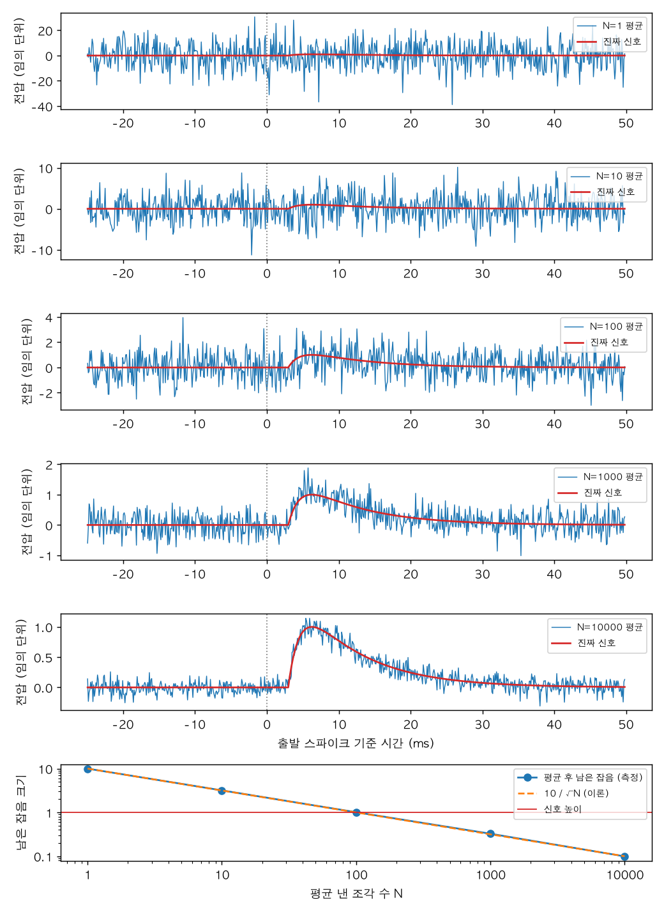
- **비유:** 시끄러운 경기장에서 같은 말을 여러 번 녹음해 겹치면 목소리만 남는다.
- **알게 된 것:** 잡음이 신호의 10배여도 N=100이면 흐릿하게, N=1,000이면 뚜렷하게 보인다. 잡음은 1/√N로 준다 (N 4배 → 잡음 절반).

### 신호 대 잡음비 — `session0/snr_explained.py`
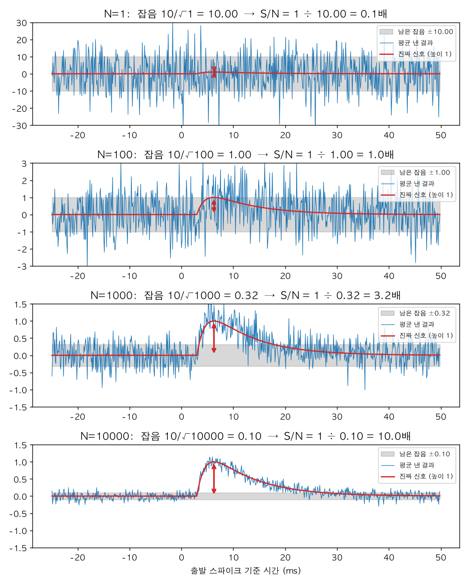
- **읽는 법:** 회색 띠 = 평균 후 남은 잡음, 빨간 화살표 = 신호 높이. 화살표가 띠의 몇 배인가가 S/N.

### 진짜 원신호 (Fig4d, EPSP 쌍) — `session0/raw_signal.py`

- **알게 된 것:** 5초에 출발 스파이크 8번뿐. 한 번만 보면 EPSP가 잡음에 묻힌다. 그래서 평균(STA)이 필요하다.

---

## M1 · 템플릿

### 샘플 = 시간 — `m1/sample_axis.py`
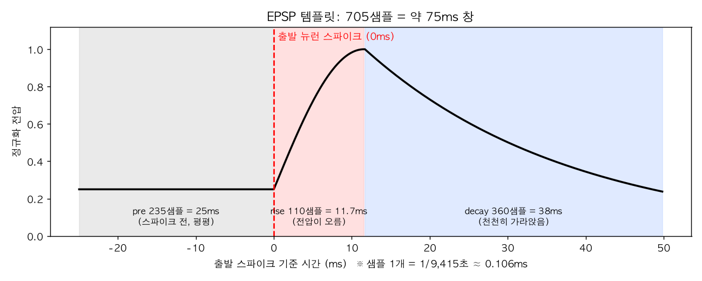
- **비유:** 전극은 1초에 9,415장 찍는 초고속 카메라. 샘플 1개 = 사진 1장 ≈ 0.106ms.
- **읽는 법:** STA 창 705샘플 = 스파이크 **전 25ms + 후 50ms**. 235번 샘플(빨간 점선)이 출발 스파이크 순간(0ms).
- **템플릿 = 세 토막:** 평평(pre) + 오름(rise) + 감쇠(나머지 칸 전부, τ는 가라앉는 속도). pre+rise가 705보다 작은 건 decay가 나머지를 채우기 때문.

### 신호 4종류 (그림 없음, 비유만)
- **컵에 차는 물:** EPSP = 물을 조금 부음(살짝 오름), IPSP = 조금 퍼 감(살짝 내려감), AP = 선을 넘으면 확 쏟아짐(크고 뾰족).
- **AP만 다음 뉴런으로 간다(말하기).** EPSP·IPSP는 받는 뉴런 안에서만 오르내린다(들은 말에 마음이 기움).
- **억제성 = 회의의 반대표.** 아무 표도 안 온 것(연결 없음)과 다르다. 흥분이 폭주하지 않게 하는 브레이크.
- **템플릿 4개의 뜻 (A의 AP 직후 B의 모양):** EPSP = 약한 흥분성, IPSP = 억제성, AP+EPSP = B가 자주 따라 AP를 내는 강한 흥분성, AP = A와 **동시** → 전기 시냅스 또는 같은 세포가 두 전극에 걸림.

### 코드 템플릿 vs Fig4a — `m1/compare_templates.py`
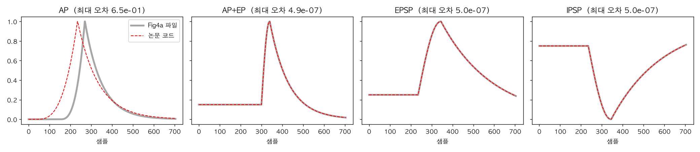
- **비유:** 같은 레시피(함수)에 재료 양(pre, rise, τ)만 다르게 넣음.
- **알게 된 것:** EPSP·IPSP·AP+EP는 오차 5e-7(엑셀 반올림)로 일치. **AP만 다름.**

### AP 템플릿 두 개 — `m1/ap_axis.py`
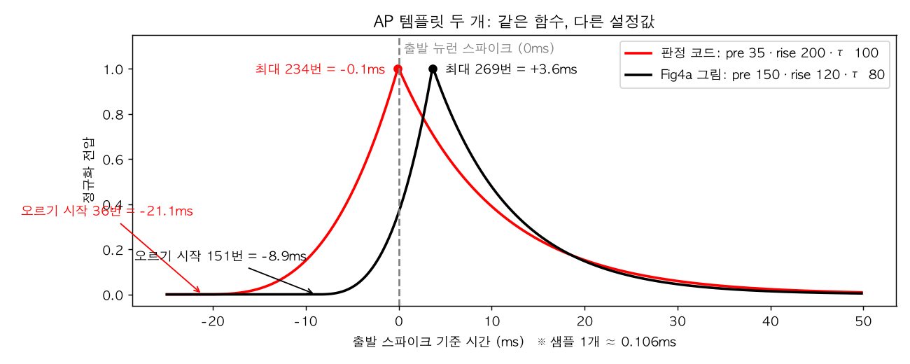
- **읽는 법:** 빨강 = 판정 코드(최대 0ms, 스파이크와 동시), 검정 = Fig4a 그림(최대 +3.6ms).
- **알게 된 것:** AP 연결의 정의가 "동시"이므로 정의에 맞는 건 코드 쪽. 둘 다 0ms 전부터 오르는 건 평균 과정의 번짐을 흉내 낸 것.
- 논문 그림 4a에서 직접 읽어도 점선 AP 꼭대기는 약 28.6ms(창 시작 기준) = 스파이크(25ms) 뒤 3.6ms.

### 템플릿 이동(정렬) — `m1/roll_demo.py`

- **비유:** 투명 필름(템플릿)을 STA 꼭대기로 **밀어서** 겹쳐 본다. STA는 그대로, 움직이는 건 템플릿.
- **왜 필요한가:** 연결마다 지연(축삭 이동 시간 + 시냅스 시간)이 달라 꼭대기 위치가 다르다.
- **알게 된 것:** 모양이 같은 가짜 EPSP에서 고정 템플릿 0.86 → 옮긴 템플릿 0.99. **AP만 옮기지 않는다**(정의가 "동시").
- **흔한 실패:** 잡음이 크면 꼭대기를 잘못 잡는다 (진짜 385 → 361). M3에서 다시 볼 문제.

---

## M2 · 판정 재현

### Fig4g AP 쌍 3,008개의 STA 최대 위치 — `m2/ap_peak_hist.py`

- **사용자 예측:** 코드 AP를 썼다면 234 근처, 그림 AP를 썼다면 269 근처에 몰린다 (옮기지 않는 템플릿이므로). **근거 맞음.**
- **알게 된 것:** 중앙값 235, 67%가 234±5, 269±5는 1.8%. → 실제 판정은 공개 코드의 AP로 했고, Fig4a 그림만 다르다.
- **덤:** 초록(EPSP) 분포가 470번(정렬 범위 끝)에 쌓여 있다. 정렬 범위 때문에 생긴 모양일 수 있다 (BACKLOG).

### Fig4c 안의 STA 모양 — `m2/fig4c_look.py`

- **읽는 법:** 위 = 진폭 큰 줄, 아래 = EPSP 상관 높은 줄, 오른쪽 = 칩 위 지도.
- **알게 된 것:** EPSP형이 칩 한 구역(22~33행, 2~16열)에 모여 있어 진짜 데이터로 보였다. 0ms에 뾰족한 5106 = 나중에 알고 보니 **출발 픽셀 자신**(거울을 본 것).

### 출발 픽셀 찾기 (그림 없음, 비유만)
- **비유: 이름 지워진 친구 조사표.** Fig4c = 한 학생이 전교생 4,096명과 친한지 조사한 표, Fig4g = 학교 전체 친구 명부.
- 5258 가설 실패 → 전교생 명부·월별 명부·설문 점수표(ED_FIG2b) 대조 모두 실패 → SI Fig 11에서 이름표 발견(**5106**) → 5106은 어느 명부에도 없음(다른 학교 학생).
- **왜 맞춰 보려 했나 = 채점 기계 검사.** 우리가 만든 채점 기계에 같은 답안지(Fig4c)를 넣어 선생님 채점(논문 판정)과 같은지 본다. 같아야 나중에 이상한 결과가 나왔을 때 "논문 방법의 틈"인지 "우리 버그"인지 구분할 수 있다.

### 정답지 행 번호 정하기 — `m2/figs/row_assign.png` (논문 그림 일부가 들어 있어 커밋하지 않음, 로컬에만)
- **읽는 법:** SI Fig 11 확대. 라벨 0.95가 27·28·29행 중 어디 붙었는지 그림 해상도로는 ±1행까지만 정해진다. 그 안에서 우리 계산값이 0.95인 줄은 28행(0.946) 하나뿐.
- **비유:** 흐린 시험지 사진에서 동그라미가 27·28·29번 중 어디인지 헷갈려, 내 채점 결과를 보고 28번으로 정한 것.
- **의미:** 재현율에는 약간의 순환이 있다. 정밀도(추가로 찾은 게 없음)와 상관값 소수점 둘째 자리 일치는 독립적인 증거.

### M2 판정 결과 — `m2/judge_fig4c.py`
| 조건 | 판정 | 맞춤 | 종류 일치 | 재현율 | 정밀도 |
|---|---|---|---|---|---|
| 코드 AP | 23 | 23 | 23 | 100% | 100% |
| 그림 AP | 25 | 23 | 22 | 100% | 92% |
| 정렬 끔 | 7 | 7 | 6 | 30% | 100% |

- **사용자 설명:** 판정 코드를 잘 만들어 기준을 통과했다. 그림 AP를 쓰면 AP가 아닌 두 곳(3608, 4110)을 AP로, EPSP인 곳(2206)을 AP로 판정한다 → 코드 AP가 맞다. 정렬을 끄면 23개 중 7개만 찾는다. 지연이 연결마다 달라 모양이 같아도 위치가 어긋나기 때문이며, AP는 "동시"가 조건이라 정렬하지 않는다.

### 판정 분포와 임계값 곡선 — `m2/threshold_curve.py`
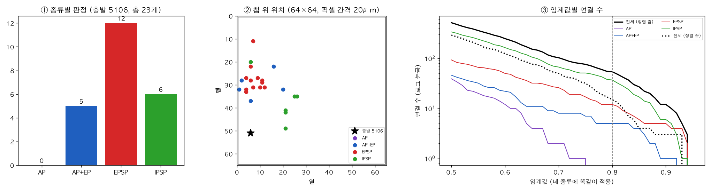
- **① 종류별:** EPSP 12, IPSP 6, AP+EP 5, AP 0 (실제 규칙: 0.80, IPSP만 0.89).
- **② 칩 위 위치:** 연결은 모두 칩 왼쪽 절반(1~26열)에 있고, 출발 5106(★)에서 15~40칸(280~800μm) 위쪽에 있다. 바로 옆 픽셀 연결은 없다.
  - [내 아이디어] **흥분(EPSP)은 흥분끼리(22~33행, 2~12열), 억제(IPSP)는 억제끼리(20~26열) 모여 있고 AP+EP는 흩어져 있다.** 연결 23개, 출발 하나뿐이라 아직 관찰 수준.
  - 지연(출발 스파이크 → STA 꼭대기/바닥)을 재 보니 종류별 중앙값이 **AP+EP 5ms < EPSP 11ms < IPSP 17ms**. 거리 중앙은 셋 다 430~470μm로 비슷하다.
  - 한 뉴런은 보통 흥분이나 억제 한 가지만 내보내는데 5106은 둘 다 만든다. 가설: IPSP는 직접 연결이 아니라 **5106 → 억제성 뉴런 → 도착**처럼 한 다리를 더 건넌 것이라 늦게 오는 것일 수 있다 (미확인).
  - 정정: 처음에 "축삭이 한 방향으로 뻗은 모습"이라고 했지만 근거가 약하다. 축삭을 따라 간다면 멀수록 늦어야 하는데 **거리와 지연의 상관이 0.14**로 거의 없다. 한쪽에 몰린 이유는 그 구역에 세포가 많거나 기록이 잘 된 픽셀이 많아서일 수도 있다.
- **③ 임계값 곡선 (네 종류에 같은 임계값):** 0.70 → 103개, 0.80 → 54개, 0.90 → 12개. 로그 눈금이라 직선에 가까우면 "임계값 0.1마다 몇 배씩" 변한다는 뜻.
  - **왜 0.80에서 23개가 아니라 54개인가:** 실제 규칙은 IPSP만 0.89다. 곡선을 실제 규칙대로 그리려면 x축 하나에 임계값 두 개(나머지 t, IPSP t+0.09)를 함께 움직여야 해서 읽기 어렵다. 그래서 네 종류에 **같은 값**을 적용했다. 이 곡선의 0.80은 "IPSP도 0.80"이라는 뜻이고, 그 차이(IPSP 6 → 37)가 곧 아래의 발견이다. 실제 규칙의 23개는 ①·②에 있다.
- **알게 된 것:** 임계값을 모두 0.80으로 하면 **IPSP가 6개 → 37개**로 늘어난다. IPSP 템플릿이 잡음과 쉽게 닮는다는 뜻이고, 그래서 논문이 IPSP만 0.89로 올렸다고 볼 수 있다 (논문 거짓양성률도 IPSP가 9.5%로 가장 높음).
- **사용자 예측:** 0.90 → 12개 (**근거 맞음, 표에서 셈**). 0.70 → 50~60개 (방향은 맞음, 실제 103개 — 같은 규칙인 0.80의 54개 대비 약 2배).
- 점선(정렬 끔)은 모든 임계값에서 실선보다 낮다. 0.80에서 54 → 약 15.

---

## M3 · 전처리와 스파이크 검출

### Fig4d 네 쌍 위에 검출 규칙 그리기 — `m3/fig4d_look.py`
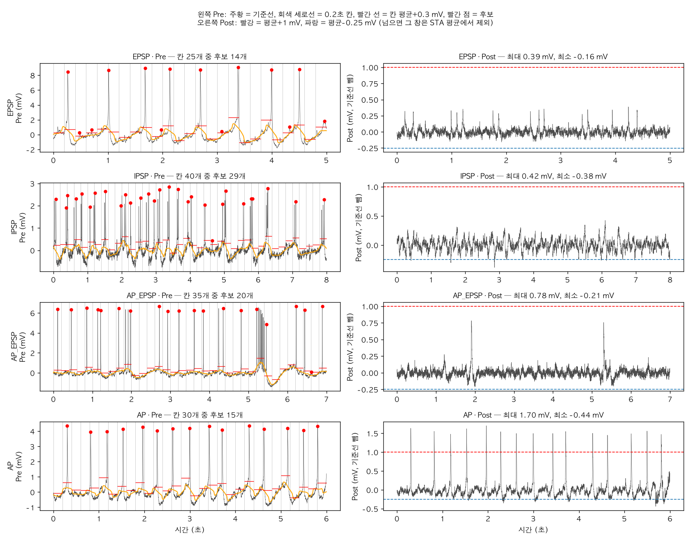
- **비유:** 0.2초짜리 칸을 자처럼 기계적으로 긋고, 칸마다 "제일 높은 봉우리가 잡음보다 확실히 높은가"만 본다.
- **읽는 법:** 왼쪽 Pre의 주황 = 기준선(천천히 흔들리는 바닥), 빨간 짧은 선 = 칸 평균 + 0.3 mV, 빨간 점 = 높이 규칙만 통과한 후보. 오른쪽 Post의 빨강/파랑 점선 = 이걸 넘는 창은 STA 평균에서 빠짐.
- **알게 된 것:**
  - 진짜 스파이크(3~9 mV)는 0.3 mV 선을 넉넉히 넘는다. 단위는 mV로 보인다.
  - 높이 규칙만 쓰면 EPSP 쌍에서 스파이크 없는 칸의 작은 봉우리 6개도 후보가 된다 (8개 진짜 + 6개 가짜). 기울기 규칙이 왜 필요한지 보여 준다.
  - AP 쌍의 Post는 Pre가 쏠 때마다 약 1.5 mV로 같이 솟는다. **+1 mV 선을 매번 넘는다.** 규칙을 그대로 적용하면 AP 창이 전부 빠질 수도 있다. 실제 코드로 확인할 것.
  - IPSP 쌍의 Post는 아래로 꺼지는 순간 몇 번이 -0.25 mV 선에 닿는다.

### 검출 + STA 창 제외까지 끝까지 — `m3/detect_fig4d.py` (규칙은 `m3/detect.py`)
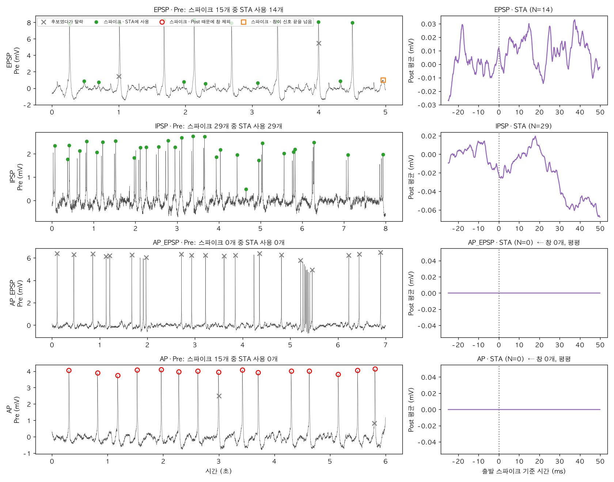
- **읽는 법:** 왼쪽 초록 점 = STA에 쓰인 스파이크, 빨간 원 = Post 때문에 창 제외, 주황 네모 = 창이 신호 끝을 넘음, 회색 X = 후보였다가 탈락. 오른쪽 = 살아남은 창의 평균(STA).
- **먼저 막힌 것:** Fig4d는 10샘플 이동평균으로 다듬은 신호라 '앰프 멈춤' 검사에 네 시트 모두 걸렸다. 이 검사만 끄고 돌렸다.
- **알게 된 것:**
  - **경계 규칙:** 스파이크가 칸 경계에 걸리면 앞 칸에는 오르막 일부(경계까지 0~1샘플)만, 뒤 칸에는 진짜 꼭대기가 들어간다. 앞 칸 것만 버려지고 스파이크는 한 번만 잡힌다 (EPSP 1.0초, 4.0초).
  - **EPSP:** 진짜 8개 + 작은 봉우리 7개가 최종 통과. 다듬은 신호라 기울기 규칙이 가짜를 못 거른다.
  - **AP_EPSP:** Pre 스파이크가 빨리 오르고 빨리 내려가서 전부 기울기 탈락 → 스파이크 0개, STA 없음.
  - **AP:** 스파이크 15개 모두 Post 때문에 창 제외 → STA 없음 (N=0이면 원본 코드는 평평한 1.0을 저장).
  - **IPSP:** 29개 모두 사용. STA는 30ms 이후 -0.06 mV쯤 내려간다.

### 직접 만든 STA를 템플릿으로 판정 — `m3/judge_fig4d.py`
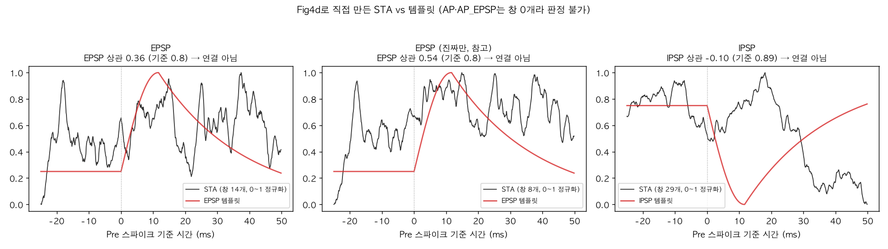
- **읽는 법:** 검정 = Fig4d로 만든 STA(0~1 정규화), 빨강 = 비교한 템플릿. 0ms = Pre 스파이크 꼭대기.
- **결과:** 판정할 수 있었던 두 쌍 모두 **연결 아님**. EPSP 0.36(기준 0.8), 진짜 스파이크 8개만 써도 0.54. IPSP는 IPSP 템플릿과 -0.10(기준 0.89).
- **알게 된 것:** 창이 8~29개뿐이라 잡음이 반응보다 크다. 논문은 20분에서 최대 500개를 쓴다. IPSP STA는 반응(10ms 근처 골) 대신 느린 바닥 흔들림이 끝으로 갈수록 내려가는 모양이 보인다 (Post 기준선은 빼지 않음).
- **추가 진단 (`m3/sta_null_check.py`, 그림 없음):**
  - 무작위 시점으로 만든 STA도 상관이 0.72~0.76까지 나온다(상위 5%). EPSP 0.36·0.54, IPSP -0.10 모두 우연 범위.
  - IPSP 쌍의 Post는 30~50ms에 실제로 꺼진다(29개 중 24개). 템플릿 정렬 허용 범위(골 12~25ms) 밖이라 음수 상관. 골을 38.8ms로 옮기면 0.891 (틈 후보 8).

## M4 · 다른 접시 대조군과 FP rate

### 종류별 FP rate 곡선 — `m4/plot_fp.py` (계산은 `m4/fp_rate.py`, `m4/compare_paper.py`)
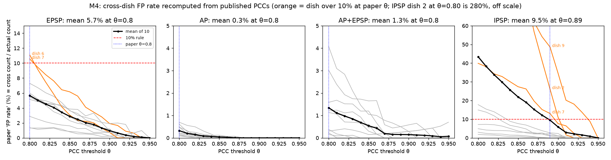
- **비유:** 다른 학교 학생끼리 궁합 점수. 친구일 수 없으니 θ를 넘으면 전부 가짜.
- **읽는 법:** x = PCC 임계값 θ, y = 논문식 FP rate (대조 접시에서 넘은 쌍 수 ÷ 실제 접시에서 넘은 쌍 수). 검정 = 10그룹 평균, 회색 = 대조 접시 하나씩, 주황 = 논문 θ(파란 점선)에서 10%(빨간 점선)를 넘은 접시.
- **알게 된 것:**
  - 평균은 논문과 반올림까지 같다 (5.7 / 0.3 / 1.3 / 9.5%). ED_FIG2e 640칸 전부 일치.
  - AP·AP+EPSP는 어느 접시로 재도 0.80에서 10% 아래.
  - EPSP는 접시 6·7이 0.80에서 10%를 살짝 넘는다 (0.81이면 통과).
  - IPSP는 접시마다 0~48.6%로 크게 퍼진다. 접시 2는 θ 0.80에서 280%(그림 밖). 같은 108쌍이 대조 접시 400만 쌍 기준으로는 0.003%.

---

## 틈 2 측정 · 창 끝에 몰린 EPSP (`gap2/`)

### 잡음 배경 확인 — `gap2/look_fig6a.py`
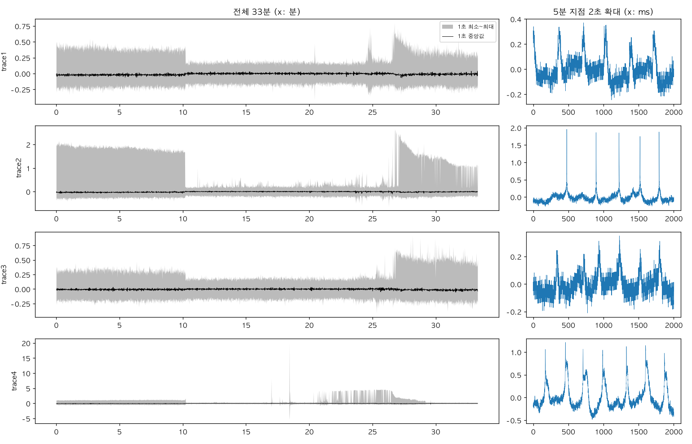
- **무엇:** ED_FIG6a 원신호 4개 (같은 칩 동시 녹음 33분). 회색 = 1초마다 최소~최대, 검정 = 1초 중앙값. 오른쪽 = 5분 지점 2초.
- **알게 된 것:** 0~10분은 규칙적으로 발화, 10~26분은 약물(CNQX+APV)로 조용, 27분 이후 다시 살아남. 스파이크는 위로 솟고 0.3~4 mV라 mV로 보인다 (확정은 아님). 짝 정보가 없으니 도착 쪽 배경으로만 쓴다.

### A: 가짜 STA의 EPSP 통과 지연 — `gap2/null_sta.py`, `gap2/plot_null.py`
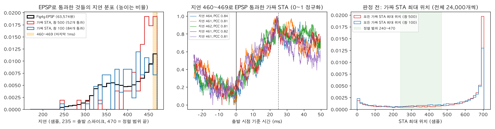
- **비유:** 빈 종이 낙서를 채점 기계에 넣고, "EPSP 도장" 받은 것들의 꼭대기 위치를 본다.
- **읽는 법:** 왼쪽 = 지연 분포 (검정 Fig4g, 빨강 가짜 창 500개, 파랑 창 100개), 주황 띠 = 460~469. 가운데 = 끝에서 통과한 가짜 STA 5개. 오른쪽 = 판정 전 모든 가짜 STA의 최대 위치.
- **알게 된 것:**
  - 가짜도 24,000개 중 52개(창 500)가 EPSP로 통과하고, **19.2%가 460~469** (기준 2배 = 8.8% 이상 → 충족). 통과한 가짜는 대부분 400 이후.
  - 오른쪽: 판정 전 가짜 STA의 최대가 **창 맨 끝(700번 근처)에 몰린다.** 무작위 평균인데 끝으로 갈수록 오르는 모양이라는 뜻.
  - 한계: 통과 52개 중 42개가 trace3 씻은 뒤 한 구간. 창 100개면 7.1%(1.6배)로 기준 미달.

### 왜 무작위 평균이 오르나 — `gap2/rule_effect.py`
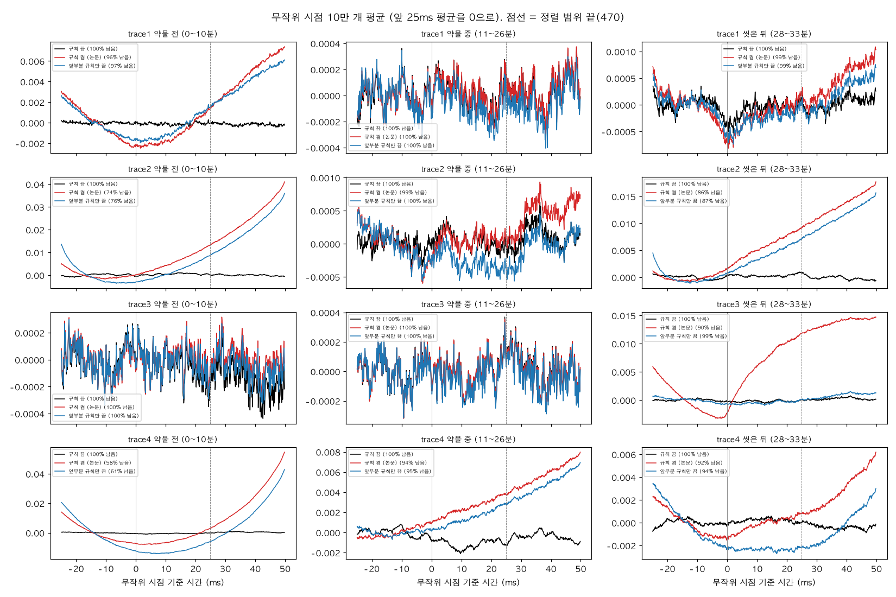
- **비유:** 앞쪽이 깨끗한 시험지만 골라 평균 내면 평균 시험지의 뒤쪽만 지저분해진다.
- **읽는 법:** 무작위 시점 10만 개 평균. 검정 = 규칙 끔, 빨강 = 논문 규칙, 파랑 = 앞부분 흔들림 규칙만 끔. 점선 = 정렬 범위 끝.
- **알게 된 것:** 규칙을 끄면 **평평**, 켜면 발화가 있는 구간에서 창 끝으로 갈수록 **오른다.** 약물로 조용한 구간은 거의 평평. 창 내용을 보고 버리는 규칙이 평균 모양을 바꾼다(선택 편향). 크기는 0.005~0.04 mV로 작지만 PCC는 크기를 무시한다.

### B: 구간 지도에 다시 나오는 횟수 — `gap2/submap_repeat.py`
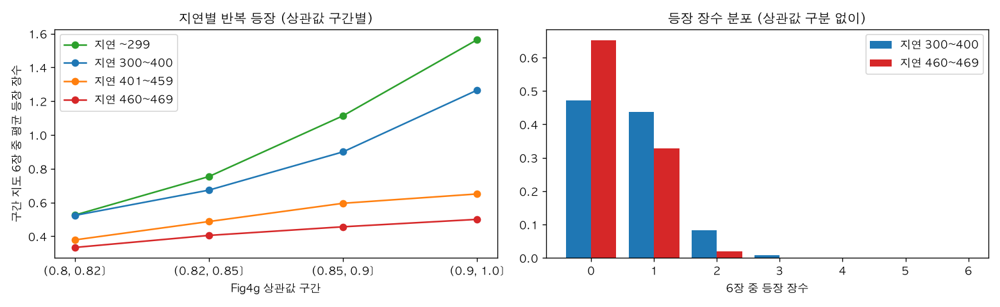
- **비유:** 출석부 6장. 진짜 학생은 여러 장에, 잘못 적힌 이름은 가끔만.
- **읽는 법:** 왼쪽 = 상관값 구간별 평균 등장 장수 (지연 구간별 색). 오른쪽 = 등장 장수 분포.
- **알게 된 것:** 같은 상관값에서 끝 지연(460~469)은 중간 지연(300~400)의 **60%**만 나온다 (기준 70% 이하 → 충족). 중간 지연은 상관이 높을수록 잘 반복되지만(0.52 → 1.27), 끝 지연은 거의 안 늘어난다(0.33 → 0.50).
- **주의:** 6장이 81개 중 어느 시점인지 모르고, 픽셀 기록 시간이 평균 32분이라 진짜 연결도 6장 중 1장 안팎에만 나온다. 늦은 진짜 연결이 원래 덜 안정적이라는 설명도 배제 못 한다.
