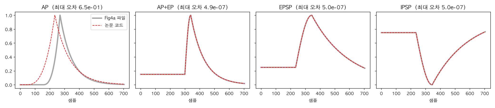
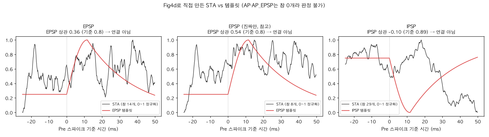
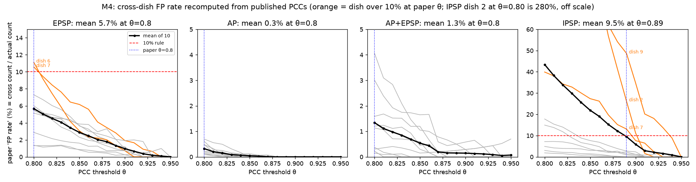
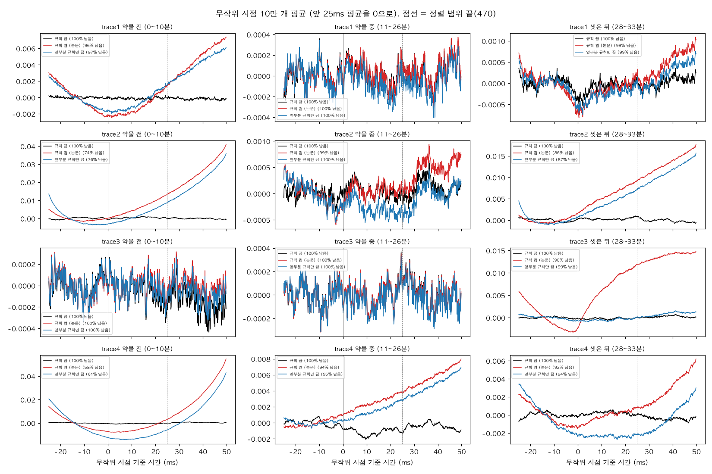

# 실험 1: 시냅스 연결 판정 재현 (STA 템플릿 매칭)

하버드 iMEA 논문(Wang et al., *Nat. Biomed. Eng.* 2025)은 4,096개 전극의 세포 내 기록에서 시냅스 연결 71,127개를 판정했다. 그 방법을 공개 데이터로 다시 해 본다. 웻랩 없이 노트북만 썼다.

## 질문

처음 해 보는 생물 분야를 논문 재현으로 이해하고, 공개 데이터로 직접 구현한 뒤, 그 방법에 틈이나 개선점이 있는지 찾는다. 판정 기준은 결과를 보기 전에 [BRIEF.md](BRIEF.md)에 적어 두었다.

## 방법

1. **STA (스파이크 촉발 평균):** 출발 뉴런이 스파이크를 칠 때마다 도착 뉴런의 전압을 75ms(스파이크 전 25ms + 후 50ms) 잘라 평균을 낸다. 연결이 있으면 일정한 굴곡이 남고, 없으면 평평해진다. 잡음은 1/√N로 준다.
2. **창 제외 규칙:** 도착 신호가 크게 튄 창(+1 mV / −0.25 mV, 앞부분 흔들림 0.4 mV)은 평균에서 뺀다.
3. **템플릿 매칭:** STA를 0~1로 정규화해 템플릿 4개(EPSP, IPSP, AP, AP+EPSP)와 피어슨 상관(PCC)을 잰다. AP를 뺀 템플릿은 STA 꼭대기(또는 바닥)로 옮겨서 비교하는데, 옮길 수 있는 범위가 정해져 있다.
4. **판정:** 가장 높은 PCC가 임계값(0.80, IPSP만 0.89)을 넘으면 그 종류의 연결로 본다.
5. **거짓양성 추정:** 다른 칩(다른 접시)의 도착 신호로 같은 계산을 해서, θ를 넘는 쌍이 몇 개 나오는지 센다.

설정값은 논문 코드([JunWISN/CNEA_Intracellular_Shared](https://github.com/JunWISN/CNEA_Intracellular_Shared))에서 확인해 [METHOD.md](METHOD.md)에 적었다. 데이터는 Harvard Dataverse의 그림 원자료다 ([DATA.md](../DATA.md)).

## 출처와 재현 환경

| 항목 | 내용 |
|---|---|
| 논문 | Wang et al., *Nature Biomedical Engineering* (2025), [doi:10.1038/s41551-025-01352-5](https://doi.org/10.1038/s41551-025-01352-5) |
| 데이터 | Harvard Dataverse, [doi:10.7910/DVN/S4B1ES](https://doi.org/10.7910/DVN/S4B1ES) (버전 6.1, CC0 1.0). 그림 원자료만 있고 긴 원신호는 없다 |
| 논문 코드 | [JunWISN/CNEA_Intracellular_Shared](https://github.com/JunWISN/CNEA_Intracellular_Shared), 커밋 `d3a8180` (2024-12-10) |
| 환경 | Python 3.14, numpy 2.5, scipy 1.18, pandas 3.1, matplotlib 3.11, openpyxl 3.1 ([requirements.txt](../requirements.txt)) |

## 코드

| 위치 | 내용 | 출처 |
|---|---|---|
| `common/data.py`, `common/test_data.py` | 데이터 경로·로더, 로더 테스트 | 이 저장소에서 작성 |
| `common/templates.py` | 템플릿 4개(AP, EPSP, IPSP, AP+EPSP) 생성 | **논문 코드에서 옮김:** `CNEALib_Mapping.py`의 `Template_AP`, `Template_PSP`, 기본 템플릿 설정(2404~2406행) |
| `common/judge.py` | STA 하나를 템플릿과 비교해 종류를 판정 | **논문 코드에서 옮김:** `CNEALib_Mapping.py` 2533~2672행 `Relation_Define_STA_v5` |
| `01_Synapse-STA/session0`, `m1`~`m4`, `gap2` | 단계별 실험 스크립트와 그림 | 이 저장소에서 작성 |

- **옮긴 코드의 권리:** 원본 저장소([JunWISN/CNEA_Intracellular_Shared](https://github.com/JunWISN/CNEA_Intracellular_Shared))에는 라이선스가 명시되어 있지 않다. 위 두 파일의 원 저작권은 원저자에게 있고, 논문 결과를 재현·검증하려는 목적으로만 옮겼다. 원저자가 요청하면 삭제한다.
- **AI 활용:** 코드는 AI 코딩 도구(Claude Code)로 작성했다. 단계마다 무엇을 확인할지, 결과를 보기 전의 판정 기준([BRIEF.md](BRIEF.md)), 결과 해석과 논문과의 비교는 내가 정했다. 내가 낸 가설은 문서에 [내 아이디어]로 표시했다. 커밋마다 `Co-Authored-By: Claude`가 붙어 있다.

**23/23의 범위:** 논문 전체의 재현율이 아니다. 출발 픽셀 5106 하나의 STA 4,095개를 판정해, 논문(SI Fig 11)이 연결로 판정한 23개를 종류까지 모두 맞힌 결과다. 검증된 것은 판정 단계(아래 ③·④)다.

## 결과

| 단계 | 한 일 | 사전 기준 | 결과 |
|---|---|---|---|
| M1 | 논문 코드 함수로 템플릿 4개 재생성 | Fig4a와 소수점 오차 수준으로 같음 | EPSP·IPSP·AP+EP 일치. **AP는 불일치**: 그림은 +3.6ms, 판정 코드는 0ms |
| M2 | 출발 픽셀 5106의 STA 4,095개 판정 | 재현율·정밀도 둘 다 95% 이상 | **23/23 성공** (재현율·정밀도 100%, 종류 23/23, PCC 소수점 둘째 자리까지 일치). 실제 판정은 코드 AP로 했다 |
| M3 | 원신호(Fig4d) → 스파이크 검출 → STA → 판정 | 성공/실패가 아니라 절차 검증 | **네 쌍 모두 논문 판정과 다름.** AP·AP+EP는 규칙에 걸려 STA를 만들지 못했고, EPSP·IPSP는 창이 14~29개뿐이라 우연 범위 |
| M4 | 다른 접시 대조군으로 FP rate 재계산 | 평균 네 개가 반올림까지 일치 / 접시 하나라도 10% 초과면 불확실 | **재현 성공** (5.7 / 0.3 / 1.3 / 9.5%, 640칸 일치). **견고성은 불확실**: EPSP 2개, IPSP 3개 접시가 10% 초과 |
| 틈 2 | 창 끝(469)에 몰린 EPSP 지연 측정 | 가짜 통과 중 끝 비율 ≥ 균등의 2배 / 구간 지도 재등장 ≤ 70% | **둘 다 충족 → 근거 있음** (4.4배, 60%) |

### 그림 1. 템플릿: 그림과 판정 코드가 다르다 (M1)


같은 함수인데 AP만 설정값이 다르다. Fig4g의 AP 쌍 3,008개는 판정 코드 쪽 위치(234번)에 몰려 있다 (67%가 ±5 안). 그래서 그림만 다르게 그린 것으로 본다.

### 그림 2. 원신호에서 직접 판정하면 (M3)


창이 14~29개뿐이라 잡음이 반응보다 크다. 무작위 시점으로 만든 STA도 PCC 0.72~0.76까지 나온다. IPSP 쌍의 반응은 30~50ms에 왔는데, 템플릿을 옮길 수 있는 범위(12~25ms) 밖이라 놓쳤다.

### 그림 3. 대조 접시마다 FP rate가 다르다 (M4)


평균은 논문과 같다. 하지만 접시 하나씩 보면 IPSP는 0~48.6%로 퍼지고, 10% 규칙을 지키는 데 필요한 θ가 접시에 따라 0.80~0.94다. 논문의 "FP rate"는 (대조 접시에서 임계값을 넘은 쌍 수) ÷ (실제 접시에서 넘은 쌍 수)로, 교과서의 거짓양성률(FPR)이나 FDR과 다른 지표다. 분모가 실제로 판정된 쌍 수라서 100%를 넘을 수 있다.

### 그림 4. 창 제외 규칙이 무작위 평균에도 오르막을 만든다 (틈 2)


무작위 시점으로 평균을 내면 원래 평평해야 한다. 규칙을 켜면 발화가 있는 구간에서 창 끝으로 갈수록 오른다. 이 오르막이 정렬 범위 끝에 걸리면 EPSP처럼 보인다.
- **빈 입력 검사:** 가짜 STA 24,000개 중 EPSP로 통과한 52개의 19.2%가 지연 460~469에 있었다 (균등하면 4.4%).
- **재등장:** Fig4g에서 끝 지연 EPSP는 같은 상관값의 중간 지연보다 구간 지도에 60%만 다시 나온다.

## 찾은 틈

| # | 틈 | 성격 | 근거 |
|---|---|---|---|
| 1 | Fig4a의 AP 템플릿(+3.6ms)이 판정 코드(0ms)와 다르다 | 확인 | M1, M2 |
| 4 | IPSP 임계값 0.89가 공개 코드에 없다 (SI Fig 11 설명에만 있음) | 확인 | M2 |
| 5 | Fig4d 예시는 원신호가 아니라 10샘플 이동평균으로 다듬은 신호다 | 확인 | M3 |
| 3 | 논문 예시 출발 픽셀 5106이 공개된 연결 지도 어디에도 없다 | 확인 | M2 |
| 6 | Fig4d의 AP 예시 쌍은 공개 코드로 판정할 수 없다 (도착 신호가 매번 +1 mV를 넘어 창이 전부 빠짐) | 확인 | M3 |
| 7 | Fig4d의 AP+EPSP 예시 쌍은 출발 스파이크가 기울기 규칙에 걸려 0개가 된다 | 확인 | M3 |
| 9 | 논문의 "FP rate"는 FPR도 FDR도 아닌 별도 지표다 (대조 접시 판정 수 ÷ 실제 접시 판정 수, 그래서 100%를 넘을 수 있음) | 확인 | M4 |
| 10 | 평균 FP rate는 대조 접시 선택에 민감하다 (IPSP에 필요한 θ 0.80~0.94) | 불확실 | M4 |
| 2 | 창 끝(469)에 몰린 EPSP 중 일부는 창 제외 규칙이 만든 오르막일 수 있다 | 근거 있음 | 틈 2 측정 |
| 8 | [내 아이디어] IPSP 정렬 범위(12~25ms)가 늦은 억제 반응을 놓칠 수 있다 | 가설 (쌍 하나) | M3 |

틈 2의 한계:
- 빈 입력 검사에서 통과한 52개 중 42개가 신호 하나의 한 구간에서 나왔다. 창 100개로 하면 기준에 못 미친다(1.6배).
- 무작위 시점은 네트워크 전체가 함께 흔들리는 효과를 흉내 내지 못한다.
- 늦은 진짜 연결이 원래 덜 안정적이라는 설명도 배제하지 못한다.

틈 8은 쌍 하나에서 결과를 본 뒤 정한 검사라 가설로만 둔다. Fig4g 전체에서 얼마나 놓쳤는지는 공개 데이터(쌍 원신호가 Fig4d 하나뿐)로 잴 수 없다.

## 열린 질문

- 전극 하나 = 뉴런 하나인가? Fig4g의 AP 쌍은 거리 중앙이 100μm이고, 바로 옆 픽셀은 13%뿐이다.
- IPSP 템플릿은 왜 잡음과 쉽게 닮는가? (임계값을 0.80으로 내리면 5106의 IPSP가 6개에서 37개로 는다)
- 늦게(30~50ms) 오는 억제 반응은 직접 연결인가, 한 다리 건넌 연결인가?
- [내 아이디어] 5106의 연결은 종류별로 모여 있고, 지연은 AP+EP 5 < EPSP 11 < IPSP 17ms다. 출발 하나뿐이라 관찰 수준이다.
- [내 아이디어] 한 쌍이 두 종류(예: EPSP와 IPSP)를 오가며 보낼 수 있나? STA는 평균이라 섞이면 상쇄되고, 판정은 하나만 고른다.

## 한계와 다음 질문

전체 과정은 ① 원신호에서 출발 스파이크 찾기 → ② 스파이크마다 도착 신호를 잘라 STA 만들기 → ③ STA를 템플릿과 비교 → ④ STA마다 종류 할당이다.

**한계**
- ③·④단계는 M2에서 검증됐다 (논문 판정 23/23 재현).
- ①·②단계는 검증하지 못했다. M3에서는 코드에 쓰인 규칙대로 진행만 했다. 논문이 찾은 스파이크 시점이 공개되지 않아 맞춰 볼 정답이 없었다.
- M4에서 같은 접시 안의 시간 섞기 대조군을 하지 못했다. 도착 신호를 시간축으로 밀어 출발 스파이크와의 인과를 끊고 판정해 보는 검사인데, 출발·도착 짝이 있는 긴 원신호가 공개되지 않았다(Fig4d의 5~8초뿐). 대신 다른 접시 대조군만 했다.
- 틈 2의 빈 입력 검사에서 EPSP로 통과한 52개 중 42개가 신호 하나의 한 시간 구간에서 나왔다. 결과가 그 구간에 크게 기대고 있다. 그 구간을 빼면 통과가 10개뿐이라 판단할 수 없다.

**다음 질문**
- STA 창을 길게 잘라 오면(예: −50 ~ +100ms) 정렬 범위 끝(25ms)에 몰리는 현상이 사라지고, 늦은 반응도 잡을 수 있을까? [내 아이디어]
- 라벨 없이 STA를 군집화하면 템플릿 4종류 외의 모양이 나올까? [내 아이디어]

## 실행

```bash
PY=~/.venvs/biocomp/bin/python

# 공통 코드 테스트
cd common && $PY test_data.py && cd ..

# 세션 0: 평균으로 잡음 줄이기
$PY 01_Synapse-STA/session0/averaging_demo.py
$PY 01_Synapse-STA/session0/raw_signal.py EPSP
$PY 01_Synapse-STA/session0/snr_explained.py

# M1 템플릿 재생성
$PY 01_Synapse-STA/m1/compare_templates.py

# M2 판정 재현
$PY 01_Synapse-STA/m2/ap_peak_hist.py
$PY 01_Synapse-STA/m2/judge_fig4c.py
$PY 01_Synapse-STA/m2/threshold_curve.py

# M3 원신호 → 검출 → STA → 판정
$PY 01_Synapse-STA/m3/fig4d_look.py
$PY 01_Synapse-STA/m3/detect_fig4d.py
$PY 01_Synapse-STA/m3/judge_fig4d.py
$PY 01_Synapse-STA/m3/sta_null_check.py

# M4 다른 접시 대조군 (fp_rate.py 약 2분)
$PY 01_Synapse-STA/m4/fp_rate.py
$PY 01_Synapse-STA/m4/compare_paper.py
$PY 01_Synapse-STA/m4/plot_fp.py

# 틈 2 측정 (첫 실행 때 ED_FIG6a 텍스트를 .npy로 캐시, 몇 분)
$PY 01_Synapse-STA/gap2/look_fig6a.py
$PY 01_Synapse-STA/gap2/null_sta.py
$PY 01_Synapse-STA/gap2/plot_null.py
$PY 01_Synapse-STA/gap2/rule_effect.py
$PY 01_Synapse-STA/gap2/submap_repeat.py
```

## 문서

[BRIEF.md](BRIEF.md) · [STATE.md](STATE.md) · [BACKLOG.md](BACKLOG.md) · [WORKLOG.md](WORKLOG.md) · [CONCEPTS.md](CONCEPTS.md) · [METHOD.md](METHOD.md) · [FIGURES.md](FIGURES.md) (그림과 설명)
